<p align="center">
  <b>Batch image processing for people with a few thousand photos and a deadline.</b><br />
  Resize, reshape, compress, convert, rename and watermark. macOS, Windows and Linux. Free and open source.
</p>

<p align="center">
  <a href="#see-every-file-before-anything-is-written">Demo</a> ·
  <a href="#what-it-does">What it does</a> ·
  <a href="#three-ways-in">Three ways in</a> ·
  <a href="#get-it">Get it</a> ·
  <a href="#licence">Licence</a>
</p>

<p align="center">
  <a href="https://github.com/GenuineMoron/img-wrangler/actions/workflows/ci.yml"></a>
  <a href="LICENSE"></a>
  
  
  <a href="https://github.com/GenuineMoron/img-wrangler/releases"></a>
</p>

Images never arrive the way you need them. A phone full of HEICs, a folder of 40 MB TIFFs from a photographer, a shoot named DSC_something, a pile of screenshots for a blog post. Too heavy, the wrong shape, named by a camera.

Wrangler sorts the lot in one pass. It shows every file as it will come out, new name, new size, new weight, before it writes a thing. Then you press Run. And if you change your mind afterwards, Undo puts the originals back.

Websites, online shops, email, social posts, slide decks, archives: whatever needs images in a particular size, shape, format or weight, a recipe does it the same way every time.

It all happens on your computer. No accounts, no uploads, no telemetry.

## See every file before anything is written


<sub>Recorded from the browser preview of the app, which plays sample photos with simulated sizes. The figures in the banner above and the right-click card are from a real run of the Web ready recipe on eight sample photos.</sub>

## What it does

| | |
|---|---|
| Resize and reshape | A long side like 2048, or full size. Keep each photo's shape, or make them all 1:1, 4:5, 3:2, 16:9 or exact pixels, by cropping, padding onto a backdrop or fitting inside. Empty background can be trimmed first. |
| Compress | Choose a look (small, balanced, high or pristine) instead of an encoder number. Each aims at a measured visual score ([SSIMULACRA 2](https://github.com/cloudinary/ssimulacra2)), and Wrangler finds the setting that reaches it for every image. Add a size limit if a platform has one. |
| Convert | Reads 14 formats, HEIC, AVIF and JPEG XL included. Writes JPEG (MozJPEG), PNG (oxipng), WebP, AVIF, GIF, TIFF, BMP, ICO, QOI, TGA and PNM. Or keeps each file's own format, or picks WebP or PNG per image. |
| Rename | Patterns with numbers, sizes and dates (`spring-24-{n:000}`), find and replace, or old and new names pasted from a spreadsheet. Clashes get numbered rather than overwritten. |
| Watermark | A logo in the same place on every image, sized to each one so portraits and landscapes match. |
| Rotate and sharpen | Quarter turns and flips, and sharpening to bring back crispness after shrinking. |
| Metadata | Strip it all, keep the camera and copyright details without the location, or keep everything. |
| Save | Beside the originals, into a subfolder, into another folder, or over the originals. Every write goes to a temporary file first, and replaced originals sit in an undo store for 30 days. |

## Three ways in

### The window

Drop files or folders anywhere on it. The four screens along the bottom are the everyday controls, and each screen is the control itself: drag the corner of the size frame, drag the red line to set a size limit, pick the format from the list. The panel on the right lists every step in the order it runs, with the rest of the settings one press away.

### Right-click


Pin recipes to the right-click menu in Finder, Explorer, Dolphin, Files (Nautilus), Nemo or Thunar. Pick one and a small window runs it straight away, shows what was saved, and keeps Undo one press away. "Open in Wrangler…" loads the selection into the main window instead. Set it up from Settings, or with `img-wrangler integrate install`.

### The command line

```sh
img-wrangler plan ~/Pictures/to-sort -r web-ready     # what would happen, nothing written
img-wrangler run ~/Pictures/to-sort -r web-ready       # do it
img-wrangler run ~/Pictures/to-sort --size 2048 --format webp --look balanced --to replace
img-wrangler run ~/Pictures/to-sort --names new-names.csv --watermark logo.png
img-wrangler undo                                      # put the last run back
```

`--json` turns the progress into JSON lines for scripts.

## Recipes

A recipe is every setting in one plain TOML file. `img-wrangler recipes show web-ready` prints one to start your own from. The app, the command line and the right-click menu all read the same files, so a recipe you tune in the window runs exactly the same from a script. These come built in:

| Recipe | What it makes |
|---|---|
| Web ready | 2560 px on the long side, WebP, balanced. Saved into a Wrangled folder. |
| Just compress | Same format and size, smaller files. Replaces the originals, with undo for 30 days. |
| Shopify product | Trimmed, centred on a 2048 px square with the photo's own backdrop, WebP. |
| Amazon main image | Pure white 2000 px square, product filling 85%, JPEG. |
| Email safe | 1200 px, JPEG, under 200 KB each. |
| Social card | 1200 × 628 link previews, cropped from the centre, JPEG. |
| Square thumbnails | 800 px squares cropped from the centre, WebP. |

## Get it

The first alpha is out. Install it with one line:

```sh
# macOS and Linux
curl -fsSL https://raw.githubusercontent.com/GenuineMoron/img-wrangler/main/install.sh | sh
```

```powershell
# Windows (PowerShell)
irm https://raw.githubusercontent.com/GenuineMoron/img-wrangler/main/install.ps1 | iex
```

On Linux it uses your own package manager: a native package on Arch and CachyOS (through `makepkg`), the `.deb` on Debian and Ubuntu, the `.rpm` on Fedora and openSUSE, and the AppImage anywhere else. The scripts are short, so read them first if you like: [install.sh](install.sh), [install.ps1](install.ps1).

Or download the files yourself from [Releases](https://github.com/GenuineMoron/img-wrangler/releases), where the notes cover each system. The builds aren't signed by Apple or Microsoft yet, so a downloaded app needs one extra click the first time. It's an alpha: try it on copies first, and [say what breaks](https://github.com/GenuineMoron/img-wrangler/issues).

### Or build it

```sh
git clone https://github.com/GenuineMoron/img-wrangler && cd img-wrangler
cargo build --release -p img-wrangler        # the command line tool, needs only Rust

cd apps/desktop && pnpm install
pnpm tauri build                             # the app, needs Node 22 and pnpm too
```

On Linux the app also needs WebKitGTK and a few friends, listed in the [Tauri prerequisites](https://v2.tauri.app/start/prerequisites/). `pnpm dev` runs the interface in a browser with sample photos, and `?demo` starts it with a shoot loaded.

## How it's made

The image work is a Rust engine (`crates/engine`): decoding, resizing, trimming, encoding, naming, the plan, the run and the undo journal. The command line tool and the desktop app are two thin front doors onto it. The app is [Tauri](https://tauri.app) with a [Svelte](https://svelte.dev) interface, drawn from one design system in `design/system`.

Every feature is a module, with an engine half and an interface half, each listed in one registry. Adding a step like the watermark took one Rust file, one interface folder and a line or two in each registry. [docs/ARCHITECTURE.md](docs/ARCHITECTURE.md) is the map and [docs/MODULES.md](docs/MODULES.md) walks through adding a feature. [DESIGN.md](DESIGN.md) covers how it looks and why.

## Help build it

Issues and pull requests are welcome. [CONTRIBUTING.md](CONTRIBUTING.md) explains the house style and how to run the tests. Contributions are accepted under the [contributor licence agreement](CLA.md), which keeps the project free for everyone and leaves room for a commercial licence later.

## Licence

Wrangler is free software under the [GNU AGPL 3.0 or later](LICENSE). Commercial licences are available from the author, see [NOTICE](NOTICE). The name and the hat are covered by the [trademark policy](TRADEMARK.md). Third-party work it builds on is listed in [THIRD_PARTY.md](THIRD_PARTY.md).

DSC_4471.JPG was never a name. It doesn't have to be one any more.
