<p align="center">
  <b>Batch image processing for people with a few thousand photos and a deadline.</b><br />
  Resize, square up, compress, convert, rename and watermark. macOS, Windows and Linux. Free and open source.
</p>

<p align="center">
  <a href="#see-every-file-before-anything-is-written">Demo</a> ·
  <a href="#what-it-does">What it does</a> ·
  <a href="#right-click-and-its-done">Right-click</a> ·
  <a href="#from-the-command-line">Command line</a> ·
  <a href="#get-it">Get it</a> ·
  <a href="#licence">Licence</a>
</p>

<p align="center">
  <a href="https://github.com/GenuineMoron/img-wrangler/actions/workflows/ci.yml"></a>
  <a href="LICENSE"></a>
  
  
</p>

A product shoot comes back as a few hundred files called DSC_something, each one heavier than any website will forgive, all of them a slightly different shape. The shop wants 2048 px squares on a clean backdrop, under 400 KB, named after the product.

Wrangler does that in one pass. It shows you every file as it will come out, new name, new size, new weight, before it writes a thing. Then you press Run. And if you change your mind afterwards, Undo puts the originals back.

It all happens on your computer. No accounts, no uploads, no telemetry.

## See every file before anything is written


<sub>Recorded from the browser preview of the app, which plays a sample shoot with simulated sizes. The figures in the banner above are from a real run.</sub>

Drop files or folders anywhere on the window. The four screens along the bottom are the everyday controls, and each screen is the control itself. Drag the corner of the size frame, drag the red line to set a size limit, pick the format from the list. The panel on the right lists every step in the order it runs, and anything more detailed is one press away there.

## What it does

### Size, shape and padding are one control



Pick how big (a long side like 2048, or full size), what shape (the photo's own, 1:1, 4:5, 3:2, 16:9, or exact pixels like 1200×628), and how the picture meets that shape. It can trim empty background first, so a product shot on a white sweep comes out centred and filling, say, 85% of the square. The backdrop is the photo's own colour by default, or white, transparent, or anything you pick.

### Compression you can read

Instead of an encoder number, choose a look: small, balanced, high or pristine. Each aims at a measured visual score ([SSIMULACRA 2](https://github.com/cloudinary/ssimulacra2) of 65, 75, 83 and 90), and Wrangler finds the setting that reaches it for every image. Add a size limit if a platform has one. And if re-saving a file in the same format and size wouldn't make it any smaller, Wrangler keeps the original.

### Names that mean something

Build names from a pattern (`spring-24-{n:000}`, `{name|slug}-{w}x{h}`), find and replace (plain or regex), or paste two columns from a spreadsheet, old name and new, and let it match them up. Clashes get numbered rather than overwritten.

### And the rest

- **Formats.** Reads JPEG, PNG, WebP, AVIF, HEIC, JPEG XL, GIF, TIFF, BMP, ICO, QOI, TGA, PNM and SVG. Writes JPEG (MozJPEG), PNG (oxipng), WebP, AVIF, GIF, TIFF, BMP, ICO and QOI.
- **Watermark.** Your logo in the same place on every image, sized to each one's shorter side so portraits and landscapes match.
- **Metadata.** Strip it all, keep the camera and copyright details without the location, or keep everything.
- **Rotate and sharpen**, for the photos that need it.
- **Safe by habit.** Every write goes to a temporary file first. Replaced originals sit in an undo store for 30 days.

## Right-click and it's done



Pin your favourite recipes to the right-click menu in Finder, Explorer, Dolphin, Files (Nautilus), Nemo or Thunar. Pick one and a small window runs it straight away, shows what was saved, and keeps Undo one press away. "Open in Wrangler…" loads the selection into the main window instead. Set it up from Settings, or with `img-wrangler integrate install`.

## Recipes

A recipe is every setting in one plain TOML file. The app, the command line and the right-click menu all read the same files, so a recipe you tune in the window runs exactly the same from a script. These come built in:

| Recipe | What it makes |
|---|---|
| Web ready | 2560 px on the long side, WebP, balanced. Saved into a Wrangled folder. |
| Just compress | Same format and size, smaller files. Replaces the originals, with undo for 30 days. |
| Shopify product | Trimmed, centred on a 2048 px square with the photo's own backdrop, WebP. |
| Amazon main image | Pure white 2000 px square, product filling 85%, JPEG. |
| Email safe | 1200 px, JPEG, under 200 KB each. |
| Social card | 1200 × 628 link previews, cropped from the centre, JPEG. |
| Square thumbnails | 800 px squares cropped from the centre, WebP. |

## From the command line

```sh
img-wrangler plan ~/Shoot -r shopify-product          # what would happen, nothing written
img-wrangler run ~/Shoot -r shopify-product            # do it
img-wrangler run ~/Shoot --size 2048 --format webp --look balanced --to replace
img-wrangler run ~/Shoot --names skus.csv --watermark logo.png
img-wrangler undo                                      # put the last run back
img-wrangler recipes show web-ready                    # print a recipe to start your own from
```

`--json` turns the progress into JSON lines for scripts.

## Get it

There's no release yet. Version 0.1 will come with installers for all three systems. Until then, build it:

```sh
git clone https://github.com/GenuineMoron/img-wrangler && cd img-wrangler
cargo build --release -p img-wrangler        # the command line tool, needs only Rust

cd apps/desktop && pnpm install
pnpm tauri build                             # the app, needs Node 22 and pnpm too
```

On Linux the app also needs WebKitGTK and a few friends, listed in the [Tauri prerequisites](https://v2.tauri.app/start/prerequisites/). `pnpm dev` runs the interface in a browser with sample photos, and `?demo` starts it with a shoot loaded.

## How it's made

The image work is a Rust engine (`crates/engine`): decoding, resizing, trimming, encoding, naming, the plan, the run and the undo journal. The command line tool and the desktop app are two thin front doors onto it. The app is [Tauri](https://tauri.app) with a [Svelte](https://svelte.dev) interface, drawn from one design system in `design/system`.

Every feature is a module, with an engine half and an interface half, each listed in one registry. Adding a step like the watermark took one Rust file, one interface folder and a line or two in each registry. [docs/ARCHITECTURE.md](docs/ARCHITECTURE.md) is the map and [docs/MODULES.md](docs/MODULES.md) walks through adding a feature. [DESIGN.md](DESIGN.md) covers how it looks and why.

## Help build it

Issues and pull requests are welcome. [CONTRIBUTING.md](CONTRIBUTING.md) explains the house style and how to run the tests. Contributions are accepted under the [contributor licence agreement](CLA.md), which keeps the project free for everyone and leaves room for a commercial licence later.

## Licence

Wrangler is free software under the [GNU AGPL 3.0 or later](LICENSE). Commercial licences are available from the author, see [NOTICE](NOTICE). The name and the hat are covered by the [trademark policy](TRADEMARK.md). Third-party work it builds on is listed in [THIRD_PARTY.md](THIRD_PARTY.md).

DSC_4471.JPG was never a name. It doesn't have to be one any more.
